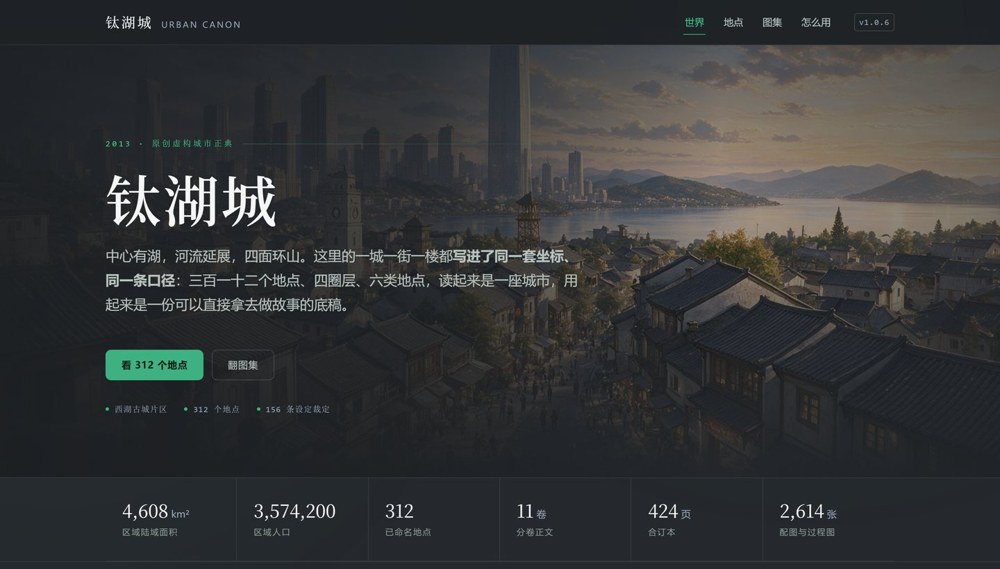
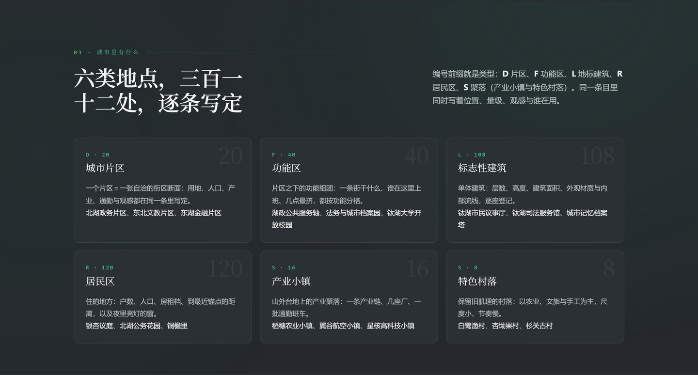
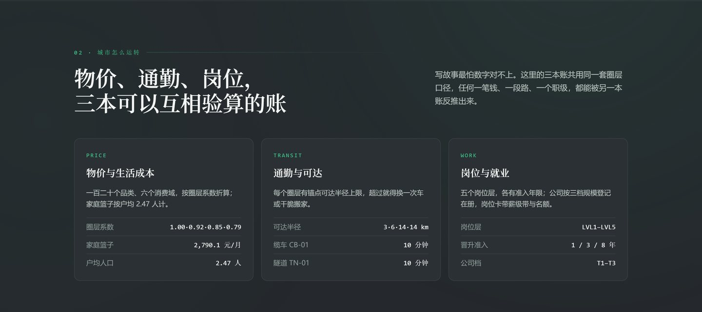
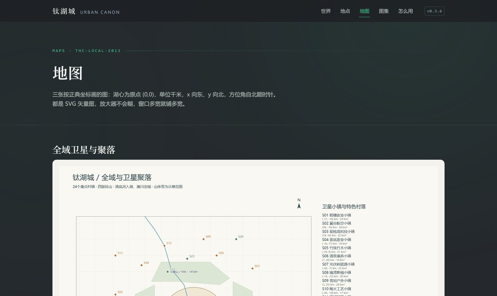
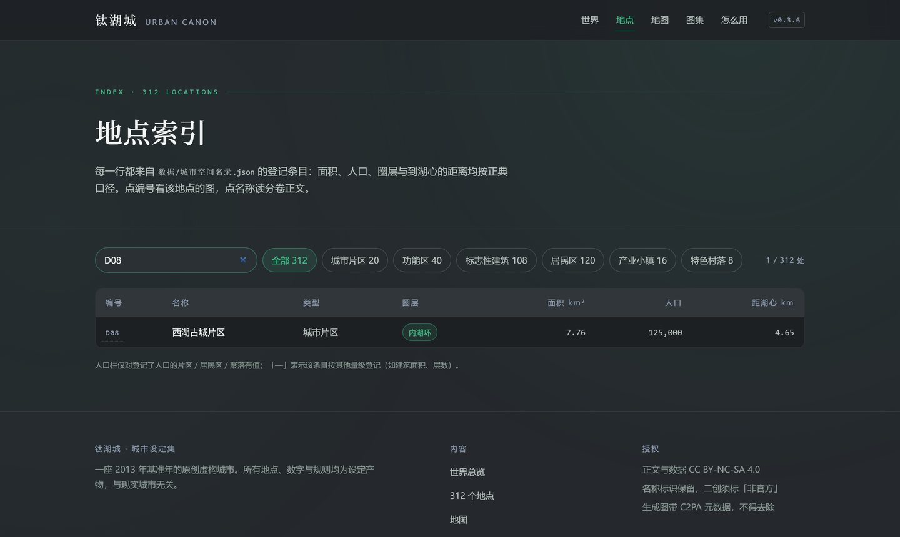
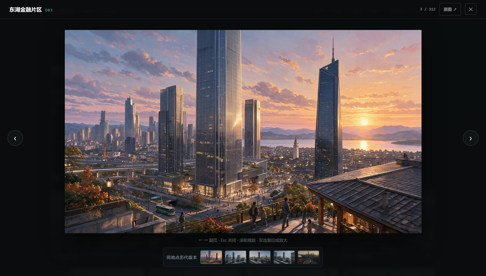
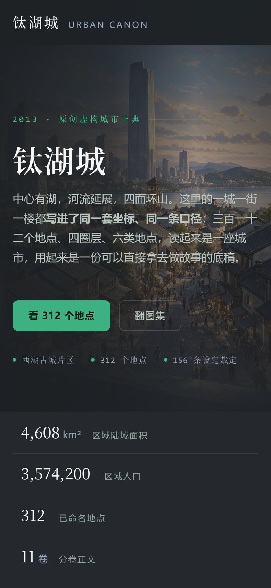

# 钛湖城城市设定集 · 基础版 v0.3.6

一座**完全虚构**的环湖城市，基准年 **2013**。312 个地点逐个有坐标、面积、人口、形态与生活叙事；配套一套可核验的经济、通勤、岗位与物价口径。

这个仓库是**设定基版**：你拿它当世界底座，在上面写故事、造人物、出图、做短视频。正典部分不许改，改了闸门会判红；叙事与创作全部开放（见 [CANON.md](CANON.md)）。

---

## 一分钟上手

```powershell
# 1. 看城市
打开 网站/index.html             # 介绍网站：世界总览 / 312 地点索引（可搜索）/ 地图 / 图集墙（可放大翻页）
打开 阅读入口.md              # 312 个地点的索引表，按 ID 查
打开 00-城市总纲.md            # 一页看懂这座城

# 2. 跑一遍核验（确认你拿到的是完整基版）
python -X utf8 -m unittest discover -s 工具 -p "test_*.py"

# 3. 校验你自己的二创稿
python -X utf8 工具/validate_derivative.py 我的故事.md
```

Python 3.11+，依赖见 [REQUIREMENTS.txt](REQUIREMENTS.txt)。不装依赖也能读全部 Markdown 与 JSON。

介绍网站是纯静态四页（`网站/index.html`、`locations.html`、`map.html`、`atlas.html`），双击即可打开，不需要起服务；
图直接从 OSS 取，所以看图需要联网。页面由 `python -X utf8 工具/build_site.py` 从 `数据/` 现算生成，
改完数据重跑一次即可，`--check` 只核对盘上是否过期。预览图由 `python -X utf8 工具/shoot_site_preview.py` 重截（需 `playwright`）。

---

## 网站长什么样

四页纯静态，双击 `网站/index.html` 就能看；没有框架与构建步骤，只有 `tokens.css`、`site.css`、`lightbox.js` 三个静态件，图从 OSS 直取。



封面往下是六段：四圈层与六个数字、物价/通勤/岗位三本账、六类地点、图集精选、怎么用它、边界与授权。

<table>
<tr>
<td width="50%"><b>六类地点：312 处逐个写法</b><br />
</td>
<td width="50%"><b>物价、通勤、岗位：三本账可互相验算</b><br />
</td>
</tr>
<tr>
<td><b>地图：三张按正典坐标画的 SVG 图</b><br />
</td>
<td><b>312 行地点索引：可按类型筛选、按编号/名称搜索</b><br />
</td>
</tr>
</table>

索引表每行两条链：点**编号**跳到图集里那一格（`atlas.html#t-D08`），点**名称**打开 GitHub 上的分卷正文。

图集墙：312 个地点的在册图，点开就能放大看——`←` `→` 翻页、滚轮或双击缩放（放大后可拖动）、手机左右滑、`Esc` 关闭，
右上角「原图 ↗」直接给 OSS 原文件；同一地点若有多轮成果，弹层底部会列出「同地点历代版本」，点缩略图即切换。



手机上全部单列，图集墙两列：



---

## 里面有什么

| 路径 | 是什么 | 规模 |
| --- | --- | --- |
| `00-城市总纲.md` | 城市总纲：地理、人口、产业、规则索引 | 1 份 |
| `网站/` | 介绍网站：世界总览、312 地点索引（筛选＋搜索）、地图、图集墙（放大翻页＋历代版本）；样式照 `D:\work\mxaiSpace\taihucheng` | 4 页 + 3 静态件（`地图/` 为 SVG 副本，`预览/` 9 张截图） |
| `阅读入口.md` | 312 个地点的索引表（ID／名称／类型／圈层） | 312 行 |
| `分卷/` | 11 个分卷成稿：外围村镇、城市片区、功能区、地标 4 卷、居民区 4 卷 | 312 地点详档 |
| `分卷/原稿/` | **手写真源**：一地的正文从这里进 | 32 份 |
| `数据/*.json` | 正典与账本：空间名录、物价、通行、产业就业、岗位准入、开图清单等 | 95 个 JSON |
| `数据/开图提示词/` | 每个地点一条可直接投喂文生图模型的完整提示词 | 312 条 |
| `工具/` | 生成器、闸门与单测：改真源→重跑全链 | 911 项单测 |
| `设计/` | 实施计划、交接清单、[项目收口说明](设计/2026-11-27-项目收口说明.md)、[结构整理](设计/2026-11-27-项目结构整理.md) | 25 份 |
| `示例/` | 角色卡与一周时间线样板：造人的起点，每个数字都标了正典出处 | 2 份 |
| `钛湖城城市设定集-完整合订本.md` / `.docx` | 424 页合订本（含 321 张表） | 1.23 MB / 583 KB |

地点 ID 前缀即类型：`S` 聚落 24、`D` 城市片区 20、`F` 功能区 40、`L` 标志性建筑 108、`R` 居民区 120，合计 **312**。

---

## 图在哪儿（OSS 直链）

图集与母图池不入仓（2.4 GB + 311 MB），全部放在阿里云 OSS 的 `timaster` 桶（深圳）`taihucheng/` 前缀下：

- 桶是私有的，只对 `taihucheng/` 前缀放开了匿名 `GetObject`（Bucket Policy），**直链永久有效、不需要签名**；
- 仓内 `数据/图集OSS.json` 是「本地路径 ↔ 直链」对照表：`按地点`（312 个 ID 各自的几张图）与 `逐件`（2,614 条：图集 808、母图池 159、历史归档 1,163、过程图 478、运行资产 6）；人读版是同目录的 [`图集直链.md`](数据/图集直链.md)——它现在也列全这 2,614 件（第二节按树分组，每行 4 条链接）；
- 直链已经回写进账本：`数据/开图清单.json` 每条 item 的 `image_url`（与 `image_file` 逐格对齐，1,125 格全有链）、`数据/图集清单.json` 每件的 `url`——所以「项目里只存链接」在数据层成立，本地图片只是生成侧的副本；
- `数据/图集清单.json` 里每件都有 `sha256`，下载后可以逐个核对，别信任镜像站；
- 取图示例：

```python
import json
links = json.load(open("数据/图集OSS.json", encoding="utf-8"))
print(links["按地点"]["L069"][0]["url"])   # 云浦结算中心在册那格的直链
```

`工具/oss_gallery.py` 是这套东西的生成器与核对器：`--plan` 看要传什么、`--upload` 增量上传、`--verify` 逐件 HEAD 核对、`--links` 重写对照表、`--backfill` 把直链写回两个账本、`--prune` 清掉计划外的旧件。密钥只在本机 `~/.dsh/secrets/oss-ak.txt`，不进仓。

## 三条用法

### A. 只读：把这座城当素材库

读 `阅读入口.md` 找到地点，再读 `分卷/` 对应条目。每个地点都有：区位与规模、规划与空间组织、外观与细节、人群与生活节奏、关联与地方性——可直接当场景描写用。

想按主题找：`城市运行规则索引.md`（40 个主题一页速查）、`AI创作使用手册.md`（77 KB，写故事/出图的完整方法论）。

### B. 写故事：在正典上长出人物与情节

基版**不预置完整人物库**，只给「造人规则」：从地点、圈层、岗位层、住址月租、通勤半径推出一个合理的人。规则与数值全部落在 [CANON.md](CANON.md) 第 5 节，依据是仓内三份正典（产业就业／物价与生活／空间通行）。

**先看样板**：`示例/角色卡-周敏.md`（一个人，每个数字都标了出处）与
`示例/时间线-周敏的一周.md`（一周 18 条事件，带地点 ID、时长、花费）。照这两张表填自己的角色，
再用 `工具/check_samples.py` 核一遍数字有没有走样：

```powershell
python -X utf8 工具/check_samples.py 示例
```

写完后跑一次校验，确认没写错 ID、没把 69 层的楼写成 8 层：

```powershell
python -X utf8 工具/validate_derivative.py 我的故事.md --strict
```

### C. 做图 / 做视频

1. 取提示词：`数据/开图提示词/D01-北湖政务片区.txt`（每条 18–25 KB，含画风锚点、取景指令、禁画清单、量级参照）。
2. 投喂任意文生图模型（基版用豆包 Seedream 系列 pro 档出图，1792×1024 横版或 1024×1536 竖版）。
3. 出图后登记：新图放 `数据/图集/<ID>/`，再把该件补进 `数据/开图清单.json` 的 `image_file`，重跑 `python -X utf8 工具/verify_image_assets.py`。

**注意**：项目里的全部图片（图集 808 + 母图池 159 + 历史归档 1,163 + 过程图 478 + 运行资产 6，合计 2,614 件、约 4.31 GB）不在本仓库内——版权与体积原因放在 OSS，直链见 `数据/图集OSS.json` 与 `数据/图集直链.md`（见上一节）。仓里只有清单、提示词与直链表，因此克隆后本地图片相关闸门会报「缺件」，这是预期行为，不影响文本创作与参考图。视频流水线（分镜→配音→合成）同样不在本仓库，属可选扩展。

---

## 规矩（三条，其余见 CANON.md）

1. **正典字段不许手改**。坐标、面积、人口、类型、隶属、扇区几何都在 `数据/城市空间名录.json` 里，是其他一切数字的根。要改就走真源→重跑链路。
2. **改真源，不改产物**。`分卷/*.md`、合订本、`阅读入口.md`、`网站/*.html` 都是生成物；要改内容改 `分卷/原稿/*.md` 或 `数据/*源表.json`，再重跑生成器（网站跑 `工具/build_site.py`）。
3. **不许绕闸门**。仓库自带 911 项单测，包含每条判据的违例负测。红了就修源头，不要改断言。

---

## 授权

正文与数据：[CC BY-NC-SA 4.0](LICENSE.md)（署名—非商业性使用—相同方式共享）；名称与标识另有约束；二创作品须标注「非官方」。商用请先读 [LICENSE.md](LICENSE.md) 第 4 节。

---

## 版本

- **v0.3.6**（2026-11-28）：**版本号改为 0.3.6**（此前的 1.0.x 是早期编号，下面几条保留原样以便对账）。本轮内容同前一版——①新增 `map.html`，三张 SVG 正典地图上站（副本在 `网站/地图/`）；②地点索引加搜索框（编号或名称，与类型筛选可叠加）与计数，每行两条链（编号→图集那一格、名称→GitHub 分卷正文）；③图集灯箱列出「同地点历代版本」并可直接切换；④补齐 favicon、`og:`／`twitter:` 分享卡片、`theme-color`，灯箱加 `role="dialog"`／`aria-modal`／焦点陷阱／`prefers-reduced-motion`。预览生成器 `工具/shoot_site_preview.py` 入仓。
- **v1.0.6**（2026-11-28）：新增 `示例/`（角色卡＋一周时间线）与 `工具/check_samples.py`（12 条判据核样板数字）；`数据/图集直链.md` 补全「在册之外的图」（母图池／历史归档／过程图／运行资产）。
- **v1.0.5**（2026-11-28）：补上 `数据/运行时资产/` 6 件（卡面专用图 5 张＋已获得印章），`oss_gallery.py` 增 `runtime_files()`，key 落 `runtime/<相对路径>`；全部图片 2,614 件／4.31 GB。
- **v1.0.4**（2026-11-28）：本地**全部**图片上云（多出 546 件过程图与旧轮产物，共 2,608 件／4.09 GB）；`oss_gallery.py` 增 `process_files()` 把三棵 `vibe_images` 纳入计划，key 落 `archive/<原相对路径>`，与在册图分开。
- **v1.0.3**（2026-11-28）：直链回写进账本（`开图清单.image_url` 1,125 格、`图集清单.逐件.url` 808 件），历史归档图 1,095 件也上图床；`oss_gallery.py` 增 `--backfill` / `--prune`，`build_gallery_manifest.py` 重写时带回 url。
- **v1.0.2**（2026-11-27）：图集与母图池上图床（OSS `timaster` 桶，967 件 / 2.6 GB），仓内改用直链表 `数据/图集OSS.json`；拿到基版的人不再需要本地图片文件。
- **v1.0.1**（2026-11-27）：39 座地标层数/高度与副本身份口径对齐名录，合订本第 30 次渲染签改版；派生校验器 `validate_derivative.py` 补否定式与远距离数字两条口径。
- **v1.0.0**（2026-11-27）：312 地点全部定稿，156 条裁定冻结，合订本第 30 次渲染签通过（机检 + 用户弃权逐页人眼），五项判据全绿。
- 版本语义：正典字段的任何改动都算破坏性变更（升 major）；新增软性叙事、补充提示词算 minor。
- 判据冻结：C155 之后不再新增判据。看 [设计/2026-11-27-项目收口说明.md](设计/2026-11-27-项目收口说明.md)。

---

## 已知边界

| 边界 | 说明 |
| --- | --- |
| 图片不在仓、在 OSS | 2,614 件（图集 808／母图池 159／历史归档 1,163／过程图 478／运行资产 6）全部有直链，已回写进 `数据/开图清单.json` 的 `image_url` 与 `数据/图集清单.json` 的 `url`；克隆后本地没有图片文件，按链接取 |
| 网站用原图当缩略图 | 图集墙的 312 张缩略图与封面直连 OSS 原图（单张 1–4 MB，中位 2.9 MB）。该桶未开图片处理（`x-oss-process` 返回原图），要瘦身得先生成缩略图再上传，属待办 |
| 人物只有样板 | 基版给造人规则与 2 份样板，不硬编人物库；人物由你生成 |
| 视频链不在仓 | 只有到「图 + 提示词」为止，分镜/配音/合成需自建 |
| 分卷正文链到 GitHub | 站点是静态目录，`网站/` 之外的分卷不能站内跳转，所以索引里的「名称」指向 GitHub 原文；离线时这两类链点不开 |
| 424 页未逐页人眼 | 机检（空白页、压边、目录页码）通过，正文文字未逐字校对 |
| 单一归档 | 仓内已外置的大件在 `..\钛湖城卡面备份\`，与仓库同盘，不抗整盘损坏 |
